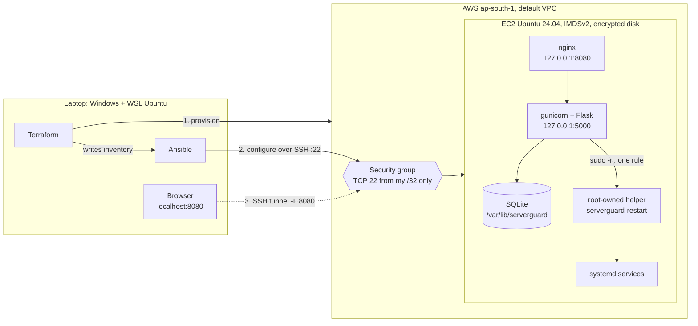

# ServerGuard

A Linux server monitoring dashboard with alerting and automated service recovery, packaged with Docker, deployed with Ansible, provisioned on AWS with Terraform, and checked by GitHub Actions CI.

> **Security note:** the dashboard has **no login**. It is therefore never exposed publicly. In every deployment it listens on loopback only, and on AWS it is reached through an SSH tunnel.


## Features

- **Live metrics:** CPU, memory, disk, network, system info (Flask + psutil)
- **Processes and services:** process table, systemd service status
- **History:** metrics stored in SQLite
- **Alerts:** threshold-based alert engine with an alerts page
- **Automated recovery:** restarts a failed service through a root-owned helper that the app may run through a single, narrow `sudo` rule
- **Settings page** for thresholds
- **141 automated tests** (pytest), Python 3.12

## Architecture



**Flow:** Terraform creates the EC2 instance and writes `ansible/inventory/aws.ini`. Ansible reads that inventory and configures the instance. You view the dashboard through an SSH tunnel, so ports 80, 5000 and 8080 are never open to the internet.

## Security model

| Control | Where |
|---|---|
| SSH ingress from one `/32` only; `0.0.0.0/0` rejected by variable validation | `terraform/variables.tf`, `main.tf` |
| Dashboard and nginx bind to `127.0.0.1` | Ansible group vars, verified by `verify.yml` |
| Code and recovery helper are root-owned; the app user cannot modify them | `roles/app`, `roles/recovery` |
| Sudoers rule allows exactly one command, validated with `visudo -cf` before install | `roles/recovery` |
| `serverguard` user: system account, no shell, no home | `roles/common` |
| IMDSv2 required, root volume encrypted | `terraform/main.tf` |
| Private key never enters Terraform state | key generated locally, only `.pub` uploaded |
| State, tfvars, keys and generated inventory are gitignored and checked by CI | `.gitignore`, `infra.yml` |

## Repository layout

```
app/            Flask app: monitoring, alerts, recovery, database, templates
scripts/        serverguard-restart (root helper), install_recovery.sh
tests/          pytest suite (141 tests)
Dockerfile, docker-compose.yml
ansible/        roles: common, app, recovery, systemd, nginx; site.yml, verify.yml
terraform/      EC2, security group, key pair, inventory output
.github/workflows/ci.yml      app tests + Docker
.github/workflows/infra.yml   terraform fmt/validate, ansible syntax + lint
docs/DEMO.md    presentation walkthrough
docs/VIVA.md    examiner Q&A
```

## Run locally

```bash
python3 -m venv .venv && source .venv/bin/activate
pip install -r requirements.txt
python run.py                    # http://127.0.0.1:5000
```

Tests:

```bash
pytest -q                        # expect 141 passed
```

Docker:

```bash
docker compose up --build        # check docker-compose.yml for the port mapping
```

## Deploy to WSL localhost (Phase 11)

```bash
cd ansible
ansible-playbook site.yml --syntax-check
ansible-lint site.yml verify.yml roles/
ansible-playbook site.yml -K     # run twice: second run must report changed=0
ansible-playbook verify.yml -K
```

Dashboard: `http://127.0.0.1:8080`

## Deploy to AWS (Phase 12)

Prerequisites: AWS CLI configured with a non-root IAM user, a billing budget, and a key pair at `~/.ssh/serverguard_aws`.

```bash
cd terraform
echo "my_ip_cidr = \"$(curl -s https://checkip.amazonaws.com)/32\"" > terraform.tfvars
terraform init && terraform plan -out tfplan && terraform apply tfplan

cd ../ansible
ansible-playbook -i inventory/aws.ini site.yml
ansible-playbook -i inventory/aws.ini verify.yml

cd ../terraform
$(terraform output -raw dashboard_tunnel_command) &   # then open http://localhost:8080
```

Tear down when finished (a running instance costs money):

```bash
terraform destroy
```

## CI

- `ci.yml`: application tests and Docker build
- `infra.yml`: no committed state or secrets, `terraform fmt -check`, `terraform init -backend=false` and `validate`, `ansible-playbook --syntax-check`, `ansible-lint`

## Known limitations

- No authentication, so access is by network isolation only (loopback plus SSH tunnel)
- Single node, SQLite storage
- No TLS (traffic stays on loopback or inside the SSH tunnel)
- Terraform state is local, not in a remote backend
- Ansible is tested by lint and a verify playbook, not by Molecule

## Possible future work

Add login and TLS, store Terraform state remotely (S3 with locking), bake an AMI with Packer, add Molecule tests for the roles, and ship alerts to email or chat.
